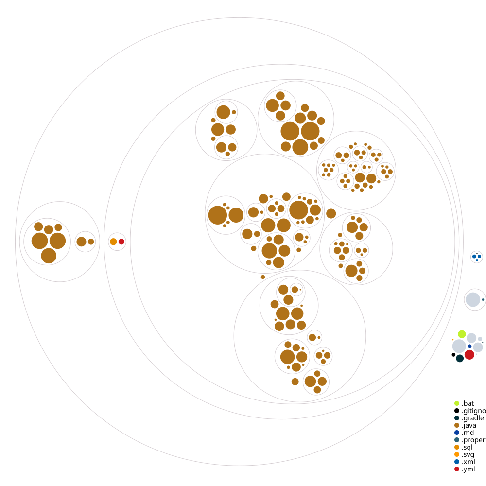

## Project Structure



```mermaid
flowchart TD
    root["BackEnd/"]

    root --> src["src/"]
    src --> main["main/"]
    main --> java["java/"]
    java --> pkg["me/jsu/springbootdeveloper/"]

    pkg --> config["config/"]
    pkg --> controller["controller/"]
    pkg --> domain["domain/"]
    pkg --> dto["dto/"]
    pkg --> repository["repository/"]
    pkg --> scheduler["scheduler/"]
    pkg --> service["service/"]

    %% config 하위 패키지
    config --> jwt_pkg["jwt/"]
    config --> oauth_pkg["oauth/"]
    
    %% config 패키지 내부
    config_pkg --> oauth_security_config["OAuthSecurityConfig.java"]